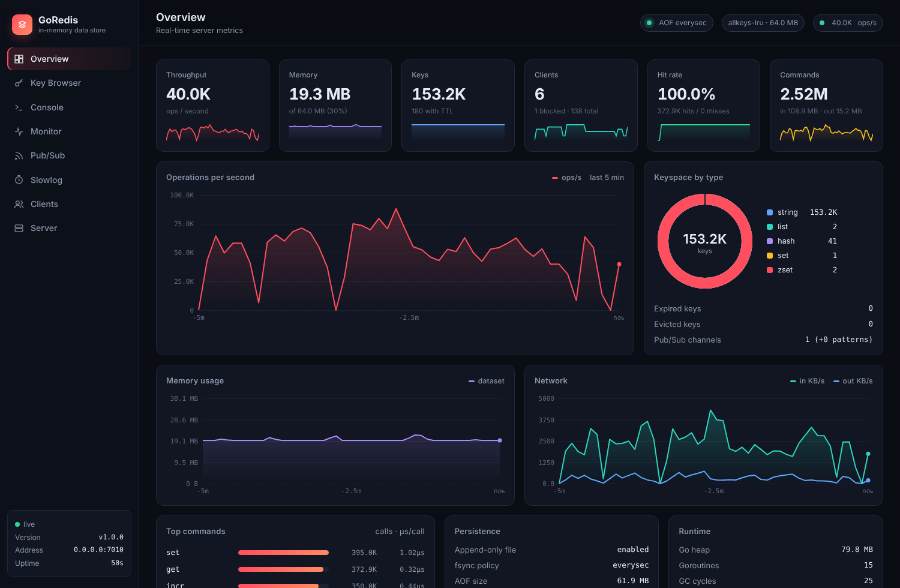
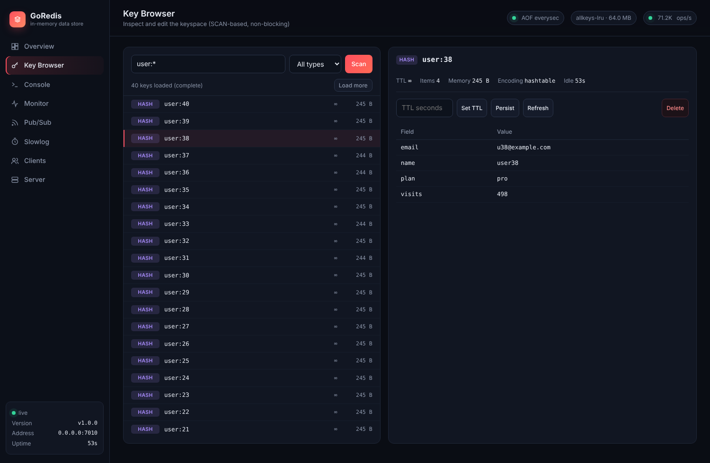
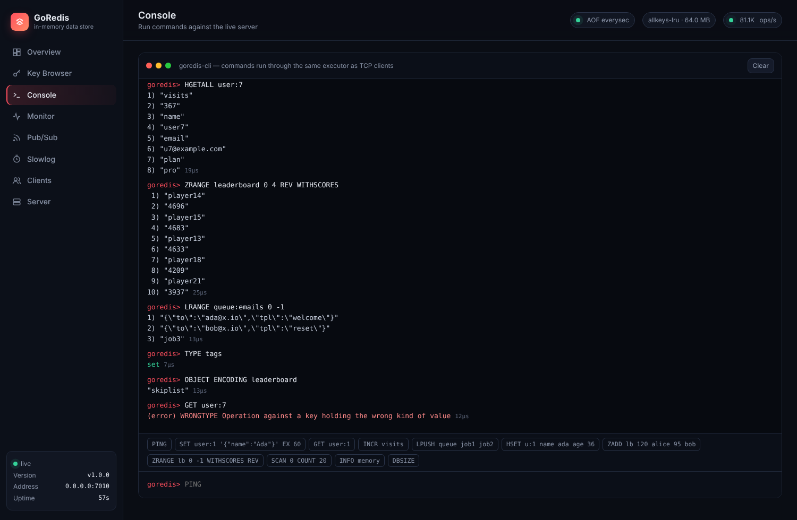
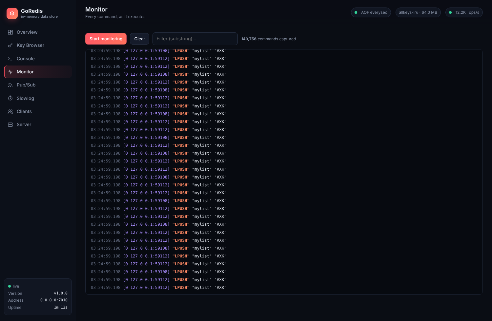
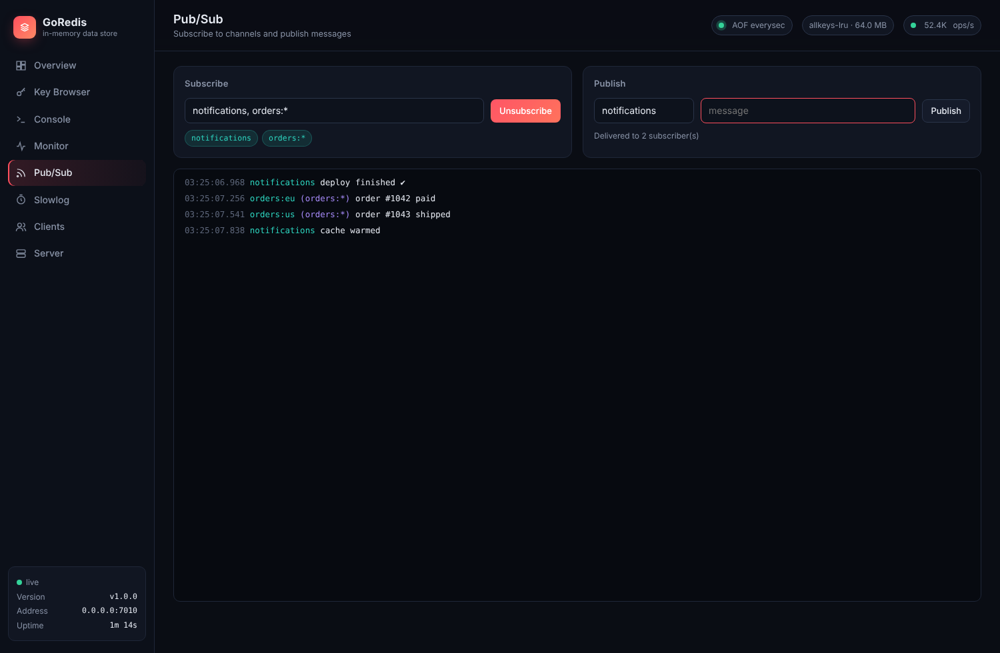
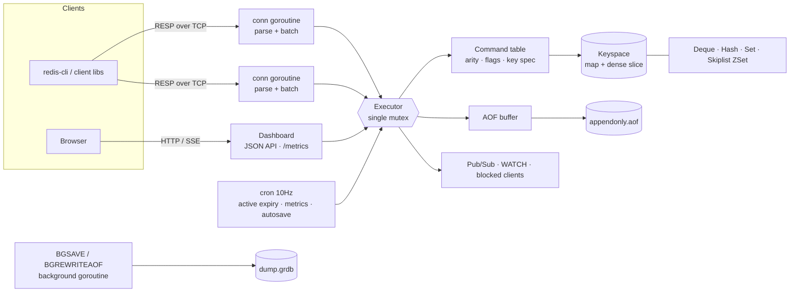

# GoRedis

**A Redis-compatible in-memory data store written from scratch in Go — with persistence, pub/sub, transactions, blocking queues, LRU eviction and a real-time web dashboard.**

Zero third-party dependencies. Works with the official `redis-cli`, `redis-benchmark`, and any Redis client library (go-redis, redis-py, ioredis, Jedis…).




---

## Highlights

| | |
|---|---|
| **135 commands** | Strings, lists, hashes, sets, sorted sets, keys, pub/sub, transactions, server/admin |
| **Wire compatible** | RESP2 parser handling multibulk + inline (telnet) requests, pipelining, binary-safe values |
| **Fast** | Matches real Redis on non-pipelined workloads (~100–120K ops/s per run on 2 cores); 560K–870K ops/s pipelined. [Benchmarks →](#benchmarks) |
| **Durable** | Append-only file (`always` / `everysec` / `no` fsync) with background **AOF rewrite**, plus CRC-checked binary **snapshots** (`SAVE` / `BGSAVE`) |
| **Data structures** | Sorted sets on a hand-written **skiplist with span-based rank** (O(log n) `ZRANK`/`ZRANGE`), ring-buffer deques for lists |
| **Memory management** | `maxmemory` with 6 eviction policies using Redis' **approximated LRU** (random sampling); O(1) per-key memory accounting |
| **Expiry** | Lazy expiry on access + Redis' **adaptive active-expiry cycle** (probabilistic sampling) |
| **Concurrency** | Goroutine-per-connection I/O with a serialized executor (atomic commands, isolated `MULTI/EXEC`), optimistic locking with `WATCH`, `BLPOP`/`BRPOP` with FIFO fairness and disconnect detection |
| **Observability** | Embedded web dashboard, `INFO`, `SLOWLOG`, `MONITOR`, `CLIENT LIST`, per-command latency stats, Prometheus `/metrics` |
| **Tested** | 38 test suites (24 end-to-end over real TCP), randomized property tests for the skiplist, a fuzzed protocol parser, all green under `-race`; CI runs the official Redis tools against the server |

## Quick start

```bash
git clone https://github.com/kavya-patel-1310/goredis && cd goredis
make run                      # builds, starts on :6379 with AOF, dashboard on http://127.0.0.1:8080
```

In another terminal, use the real Redis CLI:

```text
$ redis-cli
127.0.0.1:6379> SET user:1 '{"name":"Ada"}' EX 60
OK
127.0.0.1:6379> ZADD leaderboard 120 alice 95 bob 140 carol
(integer) 3
127.0.0.1:6379> ZRANGE leaderboard 0 -1 REV WITHSCORES
1) "carol"
2) "140"
3) "alice"
4) "120"
5) "bob"
6) "95"
127.0.0.1:6379> BLPOP jobs 0          # blocks until another client pushes
```

Or with Docker:

```bash
docker compose up -d          # RESP on :6379, dashboard on :8080, data in a volume
```

### Configuration

```
goredis [flags]
  -port 6379                    RESP port
  -bind 0.0.0.0                 bind address
  -dashboard 127.0.0.1:8080     dashboard address ("" disables it)
  -dir .                        directory for appendonly.aof / dump.grdb
  -appendonly                   enable the AOF
  -appendfsync everysec         always | everysec | no
  -save "60 1000"               snapshot if ≥1000 writes in 60s ("" disables)
  -maxmemory 0                  e.g. 256mb, 1gb
  -maxmemory-policy noeviction  noeviction | allkeys-lru | volatile-lru | allkeys-random | volatile-random | volatile-ttl
  -requirepass ""               password for clients and the dashboard
  -slowlog-log-slower-than 10000  µs
```

Most of these can also be changed at runtime with `CONFIG SET`.

## Web dashboard

A single self-contained page embedded in the binary (`go:embed`), streaming live data over Server-Sent Events. No JavaScript frameworks or chart libraries — charts are drawn on `<canvas>` by hand.

| Key browser | Console |
|---|---|
|  |  |
| **Monitor** | **Pub/Sub** |
|  |  |

- **Overview** – ops/sec, memory, network, hit rate, keyspace composition, top commands with µs/call, persistence status
- **Key browser** – SCAN-based (never blocks the server), type-aware viewers, TTL editing, delete
- **Console** – run any command through the same executor as TCP clients, with history
- **Monitor** – live stream of every command (like `MONITOR`)
- **Pub/Sub** – subscribe to channels/patterns and publish from the browser
- **Slowlog / Clients / Server** – slow commands, connected clients (kill), live `CONFIG SET` editing, full `INFO`
- **`/metrics`** – Prometheus exposition format for Grafana

## Architecture



Full write-up: **[docs/ARCHITECTURE.md](docs/ARCHITECTURE.md)**. The short version:

- **Concurrency model.** Each connection has a goroutine that does socket I/O and RESP parsing in parallel; command *execution* is serialized by one mutex, like Redis' single-threaded event loop. That makes every command atomic and `MULTI/EXEC` isolated with no fine-grained locking — the same split Redis 6+ uses with I/O threads.
- **Pipelining.** The parser can tell whether the read buffer already holds complete commands without doing I/O, so a pipelined batch executes under a *single* lock acquisition and the replies go out in a *single* `write(2)`. Replies are flushed exactly when the reader would otherwise block on the socket.
- **Never-skip SCAN.** Keys live in a hash map *and* a dense slice. The cursor walks the slice from the end; deletion swaps the (already visited) last element into the hole, so a key that exists for the whole iteration is never missed. The slice also gives O(1) random sampling for eviction and `RANDOMKEY`.
- **Deterministic AOF.** Commands are rewritten before propagation so replay is exact: relative TTLs become `PEXPIREAT`, `INCRBYFLOAT` becomes `SET … KEEPTTL`, `SPOP` becomes `SREM` of the chosen members, evictions become `DEL`, and blocking pops are logged as `LPOP` *after* the push that served them. A torn last write after a crash is detected and trimmed on startup.
- **Slow consumers can't stall the server.** Pub/sub and monitor messages go to a per-client output buffer and are flushed by a separate goroutine; a subscriber over 32 MB of backlog is disconnected (like `client-output-buffer-limit`).

## Benchmarks

`redis-benchmark`, 500K requests, 50 clients, same 2-core VM, both servers with persistence off (`scripts/bench.sh`, raw output in [docs/benchmark-results.md](docs/benchmark-results.md)):

| Command | GoRedis | Redis 7.0 | | GoRedis `-P 16` | Redis 7.0 `-P 16` |
|---|---:|---:|---|---:|---:|
| SET | 99,681 | 105,219 | | 560,538 | 978,474 |
| GET | 119,048 | 115,902 | | 872,600 | 1,196,172 |
| INCR | 115,768 | 114,995 | | 773,994 | 1,190,476 |
| LPUSH | 115,075 | 109,004 | | 801,282 | 1,075,269 |
| ZADD | 106,022 | 104,844 | | 681,199 | 965,251 |
| LRANGE_100 | 70,353 | 61,244 | | 207,641 | 120,890 |

Without pipelining both servers are bound by network round-trips and land within a few percent of each other. With deep pipelining Redis' hand-tuned C wins on most commands (GoRedis reaches 57–83% of it), while GoRedis is faster on `LRANGE` thanks to the ring-buffer deque and batched writes. The benchmark client shares the same 2 cores, so treat these as relative numbers.

**Optimizations that came out of profiling** (`pprof`): batch execution of pipelined commands under one lock; one allocation for all arguments of a command instead of one per argument; reading the clock twice per command instead of four times (`time.Now` was 11% of CPU on this VM).

## Commands

<details>
<summary>All 135 supported commands</summary>

- **Strings:** GET SET (NX XX GET EX PX EXAT PXAT KEEPTTL) SETNX SETEX PSETEX GETSET GETDEL MGET MSET MSETNX INCR DECR INCRBY DECRBY INCRBYFLOAT APPEND STRLEN GETRANGE SETRANGE
- **Keys:** DEL UNLINK EXISTS TYPE EXPIRE PEXPIRE EXPIREAT PEXPIREAT (NX XX GT LT) TTL PTTL PERSIST KEYS SCAN (MATCH COUNT TYPE) RANDOMKEY RENAME RENAMENX DBSIZE FLUSHDB FLUSHALL OBJECT MEMORY
- **Lists:** LPUSH RPUSH LPUSHX RPUSHX LPOP RPOP (count) BLPOP BRPOP LLEN LRANGE LINDEX LSET LREM LTRIM LINSERT LPOS RPOPLPUSH LMOVE
- **Hashes:** HSET HMSET HSETNX HGET HMGET HDEL HLEN HEXISTS HSTRLEN HGETALL HKEYS HVALS HINCRBY HINCRBYFLOAT
- **Sets:** SADD SREM SISMEMBER SMISMEMBER SMEMBERS SCARD SPOP SRANDMEMBER SINTER SUNION SDIFF SINTERSTORE SUNIONSTORE SDIFFSTORE SMOVE
- **Sorted sets:** ZADD (NX XX GT LT CH INCR) ZINCRBY ZREM ZSCORE ZMSCORE ZCARD ZCOUNT ZRANK ZREVRANK ZRANGE (BYSCORE REV LIMIT WITHSCORES) ZREVRANGE ZRANGEBYSCORE ZREVRANGEBYSCORE ZPOPMIN ZPOPMAX ZREMRANGEBYRANK ZREMRANGEBYSCORE
- **Pub/Sub:** SUBSCRIBE UNSUBSCRIBE PSUBSCRIBE PUNSUBSCRIBE PUBLISH PUBSUB (CHANNELS NUMSUB NUMPAT)
- **Transactions:** MULTI EXEC DISCARD WATCH UNWATCH
- **Server:** PING ECHO QUIT AUTH HELLO SELECT RESET CLIENT (ID SETNAME GETNAME LIST KILL INFO) INFO CONFIG (GET SET RESETSTAT) COMMAND TIME SLOWLOG MONITOR SAVE BGSAVE BGREWRITEAOF LASTSAVE SHUTDOWN DEBUG (SLEEP POPULATE)
</details>

## Testing

```bash
make race     # all tests with the race detector
make cover    # coverage
make fuzz     # fuzz the RESP parser
make bench    # GoRedis vs redis-server with redis-benchmark
```

- **Integration tests** start a real server on a random port and talk RESP over TCP: every data type, expiry (lazy + active), blocking pops (wakeup, timeout, FIFO fairness, client disconnect), transactions + WATCH, pub/sub, pipelining 10K commands, 20 concurrent writers, auth, LRU eviction, memory accounting, AOF round-trip, truncated-AOF recovery, AOF rewrite during writes, snapshot round-trip and CRC corruption detection.
- **Property test**: the skiplist is checked against a sorted-slice reference model after thousands of random operations (order, rank, reverse rank, rank lookup, range counts).
- **Fuzzing** the protocol parser (`go test -fuzz`) — over a million inputs per 20 s run with no panics.
- **CI** (GitHub Actions) runs lint, race tests, a fuzz pass, a Docker build, and a compatibility job that drives the server with the official `redis-cli` and `redis-benchmark`.

## Project layout

```
cmd/goredis/          entrypoint, flags, signal handling, graceful shutdown
internal/resp/        RESP2 reader/writer, inline parsing, fuzz tests
internal/ds/          ring-buffer deque, skiplist + sorted set, hash/set with byte accounting
internal/glob/        Redis-style glob matching (KEYS, SCAN MATCH, PSUBSCRIBE)
internal/server/      networking, executor, keyspace, commands, expiry, eviction,
                      pub/sub, transactions, blocking ops, AOF, snapshots, INFO
internal/dashboard/   HTTP/SSE API, Prometheus metrics, embedded UI (static/index.html)
scripts/bench.sh      head-to-head benchmark against redis-server
```

## Roadmap

- Primary → replica replication (`REPLICAOF`, `PSYNC` with a replication backlog)
- RESP3 (`HELLO 3`) and client-side caching
- Streams (`XADD`, `XREAD`, consumer groups)
- Cluster mode with hash slots
- Lua scripting (`EVAL`)

## License

MIT
