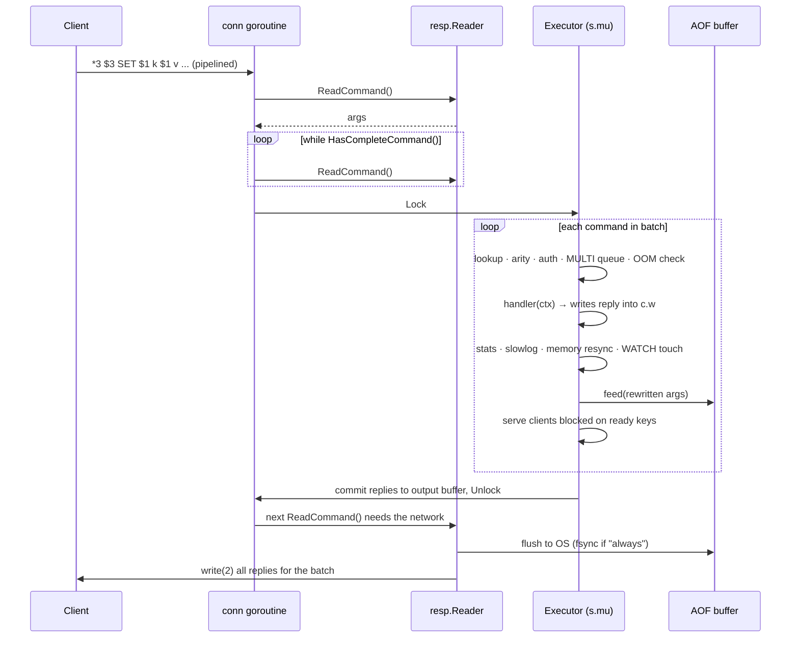

# GoRedis architecture

This document explains how GoRedis works and *why* it is built the way it is. Each section ends with the trade-off that was made, because that's what usually gets asked about.

## 1. Request lifecycle



### Concurrency model

* **One goroutine per connection** performs socket reads, RESP parsing and socket writes. These are the expensive, parallelizable parts.
* **One mutex (`Server.mu`) serializes command execution.** All data structures are touched only under it.

Why: Redis' guarantees (every command atomic, `MULTI/EXEC` isolated, `WATCH` semantics, blocking-pop ordering) fall out for free, and the data-structure code stays simple. The mutex is held for microseconds, so contention is low until a few hundred thousand ops/sec — at which point the server would be network bound anyway.

*Trade-off:* a single slow command (`KEYS *` on a million keys, `DEBUG SLEEP`) stalls everyone — exactly like Redis. The dashboard's key browser therefore uses bounded `SCAN` slices, never `KEYS`.

### Reply batching without deadlocks

The socket reader is wrapped in a `hookReader` whose `Read` is only invoked when `bufio` has run out of buffered bytes — i.e. when the server would block waiting for the client. That is precisely the moment to flush replies:

* Pipelined requests → all replies in one `write(2)`.
* Request/response clients → reply is flushed before the server waits for the next request.
* No case where the server waits for input while holding replies the client is waiting for.

Before flushing replies, the client's AOF writes are pushed to the OS, so a client never sees `+OK` for a write that isn't at least in the page cache (and fsync'ed under `appendfsync always`).

### Pipelined batches under one lock

`resp.Reader.HasCompleteCommand()` peeks at the buffered bytes and reports whether a whole request is present, without any I/O. The connection goroutine parses every complete command first, then takes the executor lock once for the whole batch.

A bug found by the test suite: an empty request (`*0\r\n`, or a blank telnet line) counted as "complete", but `ReadCommand` skips empty requests and then blocked on the socket mid-batch, deadlocking the client. `HasCompleteCommand` now skips empty requests the same way the parser does (regression test: `TestHasCompleteCommand`).

## 2. Keyspace

```go
type DB struct {
    dict     map[string]*entry   // O(1) lookup
    keys     []*entry            // dense, every key
    volatile []*entry            // dense, keys with a TTL
    used     int64               // estimated bytes
    types    [5]int              // keys per type
}
```

Each `entry` stores its index in `keys` and `volatile`. Removal swaps the last element into the hole (O(1)).

**Why the dense slices?**

1. **Random sampling in O(1)** — needed by approximated LRU eviction, the active-expiry cycle and `RANDOMKEY`. Go maps have no efficient "pick a random key".
2. **A SCAN cursor that never skips.** The cursor is a position in `keys`, walked from the end towards index 0. Deleting a key moves the *last* element (which, walking backwards, has already been visited) into the deleted slot, so an unvisited key can never jump behind the cursor. New keys are appended at the end, i.e. may or may not be returned — the same contract Redis documents. `TestKeysScanRename` deletes keys during iteration and asserts nothing is missed.

### Memory accounting

Every container (deque, hash, set, zset) maintains a running byte counter, so `entry.size()` is O(1). Each entry remembers the size last added to `DB.used` (`acct`). After any write command, the executor re-measures only the keys named in the command's key spec (`firstKey/lastKey/step`, like Redis' command table) and applies the delta. Deletions subtract `acct`. `TestMemoryAccounting` asserts that the running total equals the sum of all entry sizes after a mixed workload.

*Trade-off:* this is an estimate of dataset size (constant overheads per key/element), not Go heap usage — the dashboard shows both. Using the real heap for eviction would over-evict, since freed memory only shows up after the next GC.

## 3. Expiry

* **Lazy:** every lookup checks `expireAt` and deletes expired keys on access.
* **Active:** a 10 Hz cron samples 20 random keys from `volatile`, deletes expired ones, and repeats while more than 25 % of the sample was expired, bounded by a time budget. This is Redis' adaptive algorithm: it does almost no work when few keys are expiring and ramps up when many are, without ever scanning the keyspace. `TestExpiry` writes 500 keys with a 50 ms TTL, never touches them again, and checks they disappear.

## 4. Eviction (`maxmemory`)

Before executing any command flagged `denyoom`, if `used > maxmemory` the server evicts until under the limit:

* `allkeys-lru` / `volatile-lru`: sample `maxmemory-samples` random keys (from `keys` or `volatile`) and evict the one with the oldest access time.
* `allkeys-random` / `volatile-random`: evict a random key.
* `volatile-ttl`: evict the sampled key closest to expiring.
* `noeviction`: reply `-OOM`. Reads and deletes still work.

Evictions are propagated to the AOF as `DEL`, because random sampling isn't reproducible during replay.

*Trade-off:* approximated LRU uses no extra memory (no linked list through every key) and with 5–10 samples is very close to true LRU in practice — the reason Redis made the same choice.

## 5. Data structures

| Type | Implementation | Notes |
|---|---|---|
| string | `[]byte` | never mutated in place (`SETRANGE` copies), so snapshots can share bytes |
| list | ring-buffer deque | O(1) push/pop both ends, O(1) index; grows ×2, shrinks at ¼ |
| hash | `map[string][]byte` + byte counter | |
| set | `map[string]struct{}` + byte counter | |
| zset | hash map + **skiplist** | port of Redis' `t_zset.c` |

### Skiplist with spans

Each forward pointer stores a **span** — the number of level-0 nodes it jumps over. Summing spans along the search path gives an element's rank, so `ZRANK`, `ZRANGE start stop` and `ZCOUNT` are O(log n) instead of O(n). The map gives O(1) `ZSCORE`; the skiplist gives ordered iteration and range queries. Levels are random with p = 0.25, max 32.

`TestZSetAgainstReference` runs 10 000 random add/update/remove operations and after every batch compares the skiplist with a sorted slice: iteration order, forward and reverse rank, `ByRank` lookups, score-range counts and range iteration in both directions.

## 6. Blocking operations

`BLPOP k1 k2 timeout`:

1. If any key has data, pop immediately (propagated as `LPOP`).
2. Otherwise register the client in `blockingKeys[k]` (FIFO per key) and return without a reply. The connection goroutine releases the executor lock and parks on `select { served | timeout | disconnected | shutdown }`.
3. A push calls `signalKeyReady(k)`. *After* the pushing command has been propagated to the AOF, the executor serves waiting clients in FIFO order, writes their replies into their output buffers, propagates `LPOP`, and wakes them.

Two details:

* **Order in the AOF** must be push → pop, otherwise replay pops from an empty list. Serving waiters after propagation (Redis' `handleClientsBlockedOnKeys`) guarantees it.
* **Disconnect detection while parked.** The goroutine isn't reading, so a dead client would sit in the queue and swallow the next pushed element. A helper goroutine calls `bufio.Reader.Peek(1)`, which blocks until data or EOF *without consuming bytes*. On EOF the client is unregistered. When the wait ends, a past read deadline unblocks the peek before the connection loop reuses the reader. `TestBlockedClientDisconnect` asserts the element isn't lost.

## 7. Transactions

* `MULTI` → commands are validated (existence, arity) and queued; a validation error marks the transaction to abort with `EXECABORT`.
* `EXEC` → runs the queue under the executor lock (already atomic). Runtime errors (e.g. `WRONGTYPE`) are returned per command without rollback, matching Redis.
* `WATCH` → `watched[key]` maps to the watching clients; every modification of a key (write commands, expiry, eviction, `FLUSHALL`) marks them dirty, and `EXEC` returns nil if the client is dirty.
* Inside `EXEC`, writes are wrapped in `MULTI … EXEC` in the AOF so a partially written transaction can be detected on load.

## 8. Pub/Sub and output buffers

Subscribers are an interface (`deliver(pattern, channel, msg)`), implemented by network clients and by the dashboard's in-process sinks. Patterns use the same glob matcher as `KEYS`.

`PUBLISH` runs under the executor lock, so it must never block on a slow subscriber's socket. Each client has an output buffer guarded by its own small mutex; asynchronous producers append to it and, if no flush is in progress, start a flush goroutine. The flushing goroutine swaps the buffer out and writes *without* holding the buffer lock. A subscriber whose backlog exceeds 32 MB is disconnected.

## 9. Persistence

### Append-only file

* Write commands are encoded as RESP into an in-memory buffer during execution.
* The buffer reaches the OS before the client's reply is sent (see §1).
* `everysec`: a background goroutine fsyncs once a second, outside the AOF lock.
* **Deterministic rewriting before propagation:**

| Executed | Logged as | Why |
|---|---|---|
| `EXPIRE k 60`, `SET k v EX 60`, `SETEX` | `PEXPIREAT k <abs>`, `SET k v PXAT <abs>` | replay later must keep the original deadline |
| `INCRBYFLOAT`, `HINCRBYFLOAT` | `SET … KEEPTTL`, `HSET` | float formatting must not drift |
| `SPOP`, `ZPOPMIN/MAX` | `SREM`/`ZREM` of the chosen members | randomness must not be re-rolled |
| eviction | `DEL` | sampling isn't reproducible |
| served `BLPOP` | `LPOP` after the push | replay order |

* **Loading** replays commands through the normal executor with a pseudo-client. If the last command is truncated (crash mid-write), the file is trimmed to the last complete command and loading continues (`TestAOFTruncatedTail`).
* **Rewrite (`BGREWRITEAOF`, automatic at 2× growth over 64 MB):** take a point-in-time copy of the dataset under the lock, write the minimal commands to a temp file in a goroutine, while new writes are appended to both the live AOF and a *rewrite buffer*. At the end, append the rewrite buffer, fsync, atomically `rename(2)`, fsync the directory and swap file handles. `TestAOFRewrite` writes during the rewrite and checks those writes survive a restart.

### Snapshots (`.grdb`)

```
"GOREDIS" | version | { [0xFC expireAt] type key value }* | 0xFF | CRC32
```

Varint-length strings, IEEE-754 scores, written to a temp file, fsync'ed, renamed. Loading verifies the CRC before parsing (`TestSnapshotPersistence` flips a byte and expects a checksum error). `BGSAVE` uses the same point-in-time copy as the AOF rewrite.

*Trade-off vs Redis:* Redis uses `fork()` and copy-on-write, so the snapshot costs almost nothing up front. Go can't fork safely, so GoRedis deep-copies collections under the lock (strings are shared because they're immutable). That's O(n) pause time proportional to the number of collection elements — fine for this project's scale, and the obvious next optimization would be incremental copy-on-write per key.

## 10. Observability

* `INFO` (server, clients, memory, persistence, stats, commandstats, keyspace) in Redis' format, so existing tools can parse it.
* `SLOWLOG` with configurable threshold and length; `MONITOR`; `CLIENT LIST/KILL`.
* Per-command call count, total µs and failures.
* A 1 Hz sampler keeps 5 minutes of history (ops/s, memory, keys, clients, hit rate, network) for the dashboard.
* `/metrics` in Prometheus text format.
